# Familienhub themes

Ready-made themes for [Familienhub](https://github.com/Brottuetchen/familienhub). Every theme has a light and a dark variant.

## Install

In the app: **More → Appearance → From GitHub** (admins), then paste the link of a theme from the table. The theme is then available to everyone in the family.

| Preview | Theme | Link to paste |
|---|---|---|
| <a href="candy-pop/preview-light.png">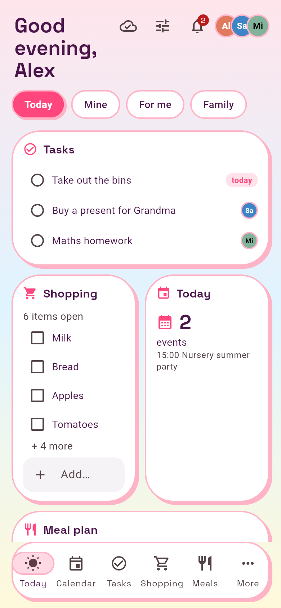</a> <a href="candy-pop/preview-dark.png">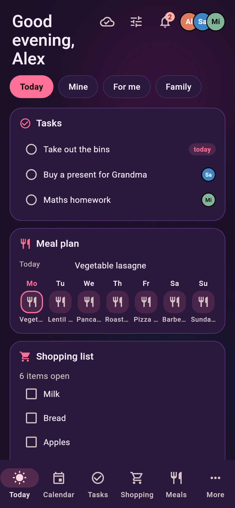</a> | **Candy Pop**<br>Bright pink and sky blue, very round cards with hard shadows, pastel gradient. | `https://github.com/Brottuetchen/familienhub-themes/blob/main/candy-pop/theme.json` |
| <a href="cyberpunk/preview-light.png">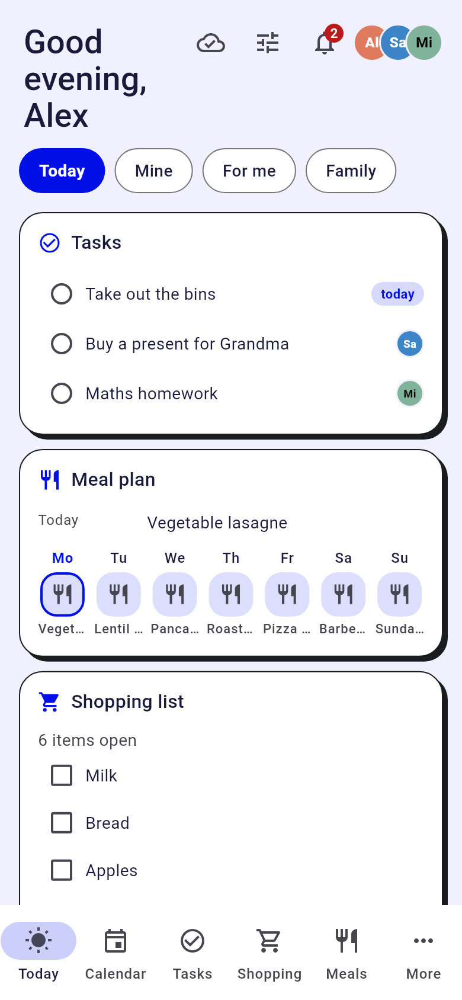</a> <a href="cyberpunk/preview-dark.png">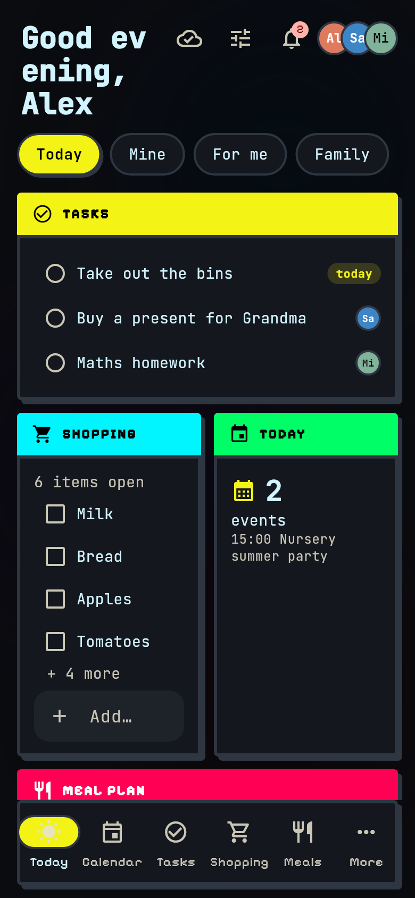</a> | **Cyberpunk**<br>Neon yellow and cyan on near-black, hard edges, terminal fonts. | `https://github.com/Brottuetchen/familienhub-themes/blob/main/cyberpunk/theme.json` |
| <a href="e-ink-reader/preview-light.png">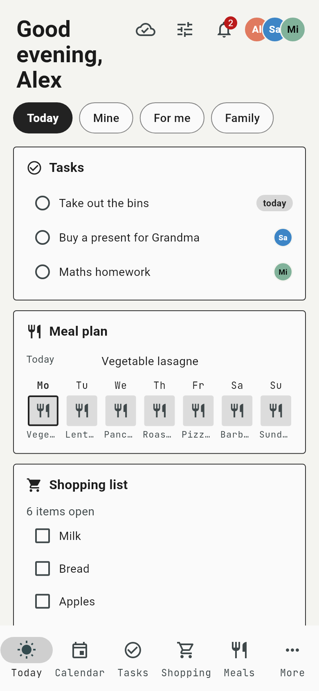</a> <a href="e-ink-reader/preview-dark.png">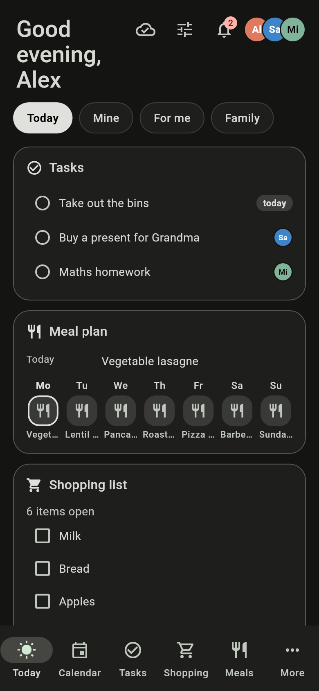</a> | **E-Ink Reader**<br>Calm greyscale like an e-reader, list layout, minimal borders. | `https://github.com/Brottuetchen/familienhub-themes/blob/main/e-ink-reader/theme.json` |
| <a href="gameboy-pocket/preview-light.png">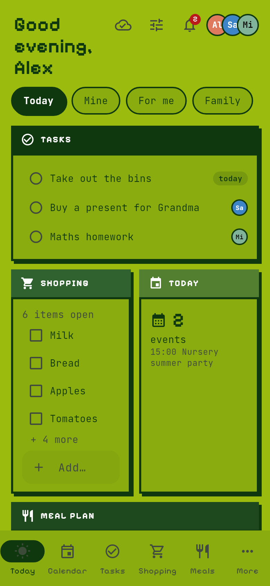</a> <a href="gameboy-pocket/preview-dark.png">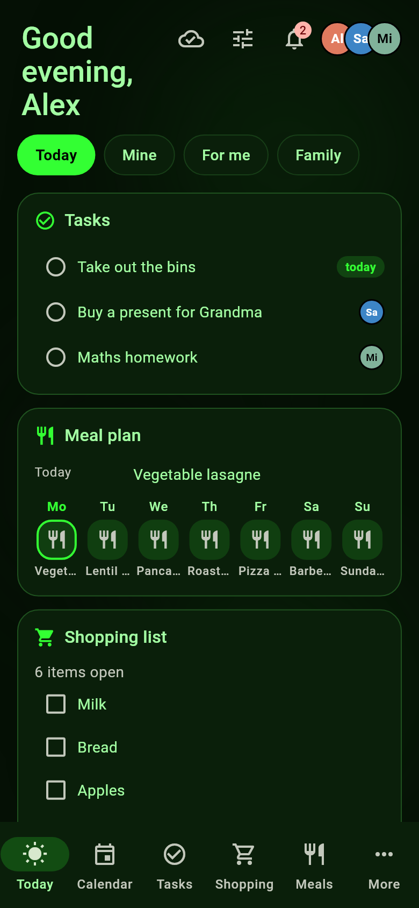</a> | **8-Bit Gameboy**<br>Four greens of the original handheld; dark variant as a green phosphor terminal. Pixel titles. | `https://github.com/Brottuetchen/familienhub-themes/blob/main/gameboy-pocket/theme.json` |
| <a href="matcha-latte/preview-light.png">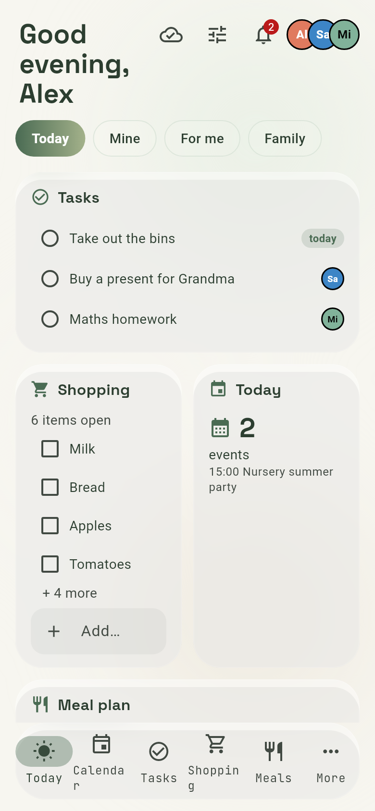</a> <a href="matcha-latte/preview-dark.png">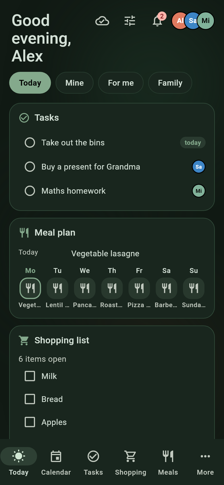</a> | **Matcha Zen**<br>Soft greens and latte tones, glass cards with a gentle glow. | `https://github.com/Brottuetchen/familienhub-themes/blob/main/matcha-latte/theme.json` |
| <a href="nordic-fjord/preview-light.png">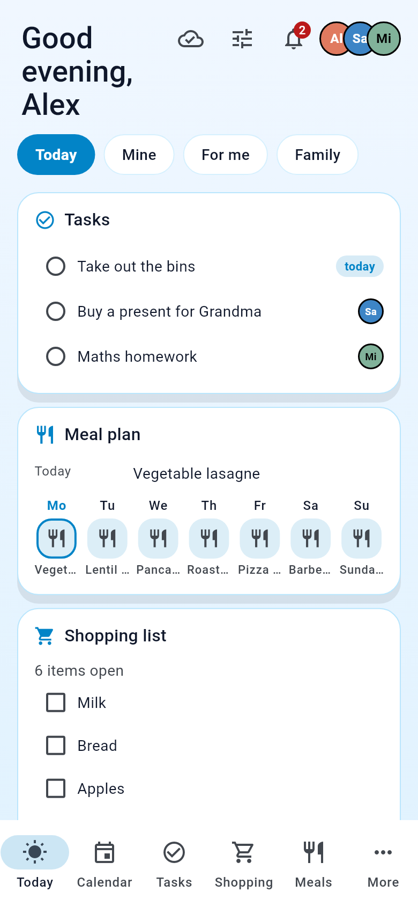</a> <a href="nordic-fjord/preview-dark.png">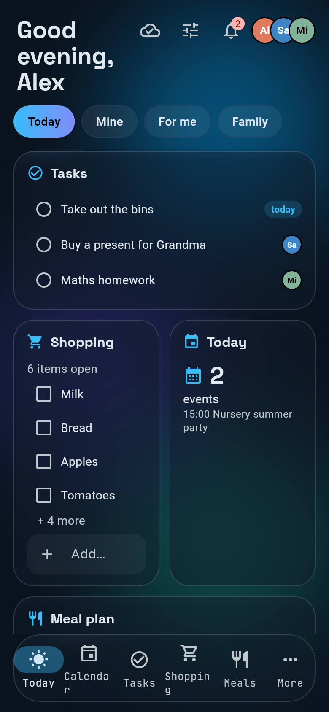</a> | **Nordic Fjord**<br>Glacier blue and violet glow, glass cards. | `https://github.com/Brottuetchen/familienhub-themes/blob/main/nordic-fjord/theme.json` |
| <a href="pitch-black-oled/preview-light.png">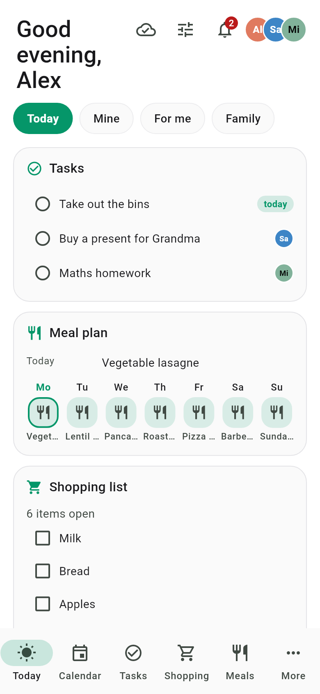</a> <a href="pitch-black-oled/preview-dark.png">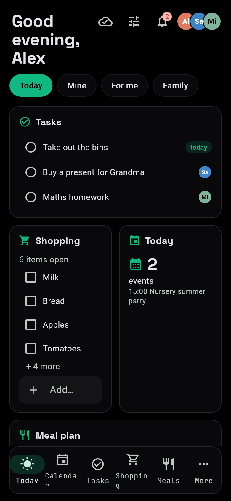</a> | **Midnight OLED**<br>True black for OLED screens with emerald and indigo accents; light variant included. | `https://github.com/Brottuetchen/familienhub-themes/blob/main/pitch-black-oled/theme.json` |
| <a href="praezision/preview-light.png">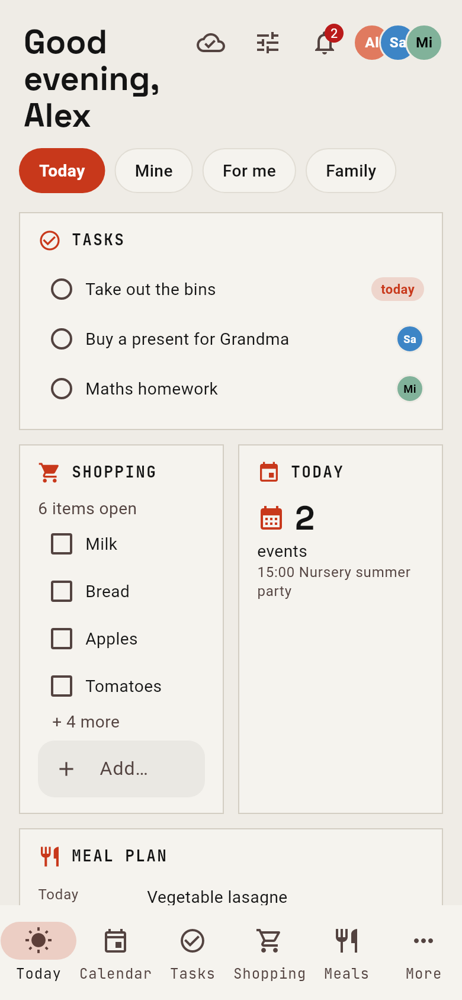</a> <a href="praezision/preview-dark.png">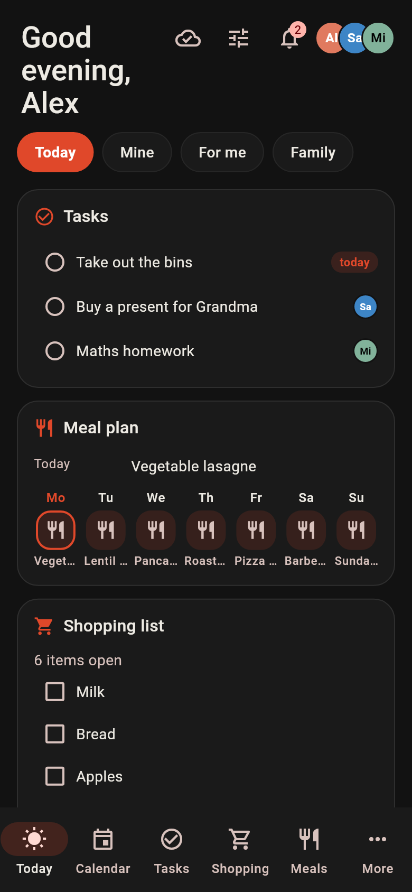</a> | **Präzision**<br>Technical measurement-report aesthetic: warm paper, signal red-orange, square panels, fine lines and mono labels. | `https://github.com/Brottuetchen/familienhub-themes/blob/main/praezision/theme.json` |
| <a href="retro-synthwave/preview-light.png">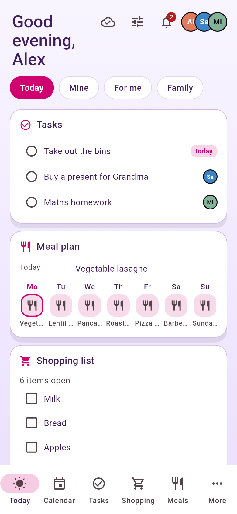</a> <a href="retro-synthwave/preview-dark.png">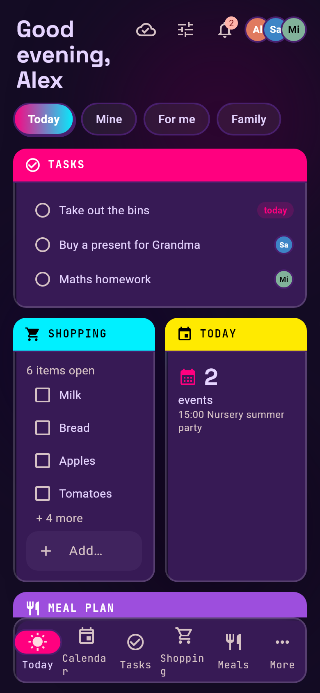</a> | **Retro Synthwave**<br>Hot pink and cyan on deep purple, 80s neon glow. | `https://github.com/Brottuetchen/familienhub-themes/blob/main/retro-synthwave/theme.json` |
| <a href="solarized-paper/preview-light.png">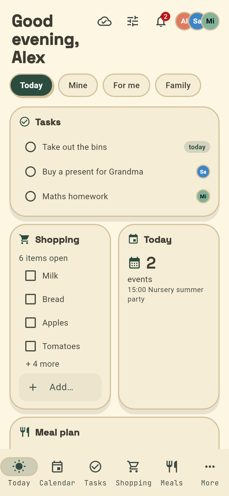</a> <a href="solarized-paper/preview-dark.png">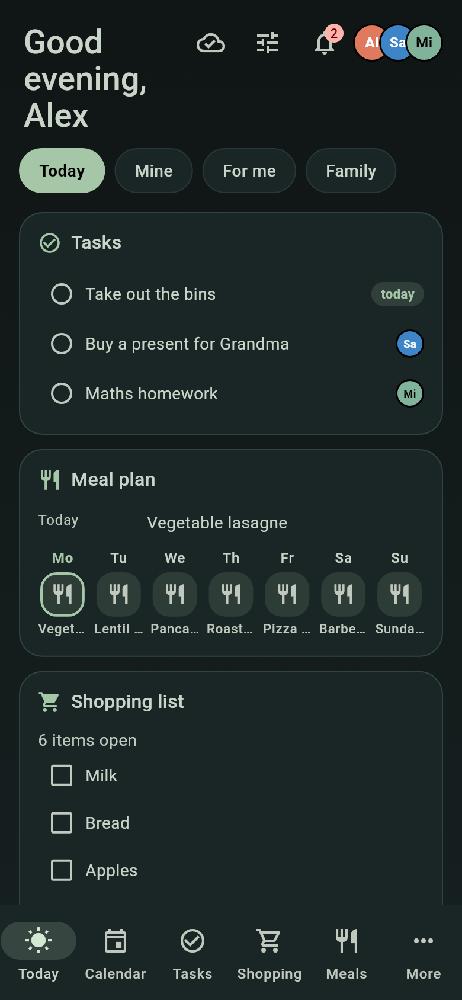</a> | **Solarized Paper**<br>Warm paper tones with forest green and brown, round cards. | `https://github.com/Brottuetchen/familienhub-themes/blob/main/solarized-paper/theme.json` |
| <a href="swiss-grid/preview-light.png">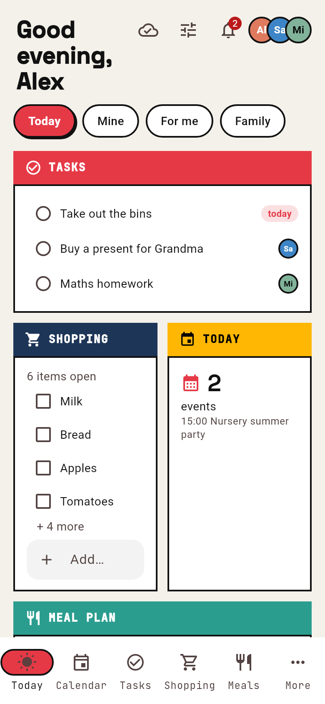</a> <a href="swiss-grid/preview-dark.png">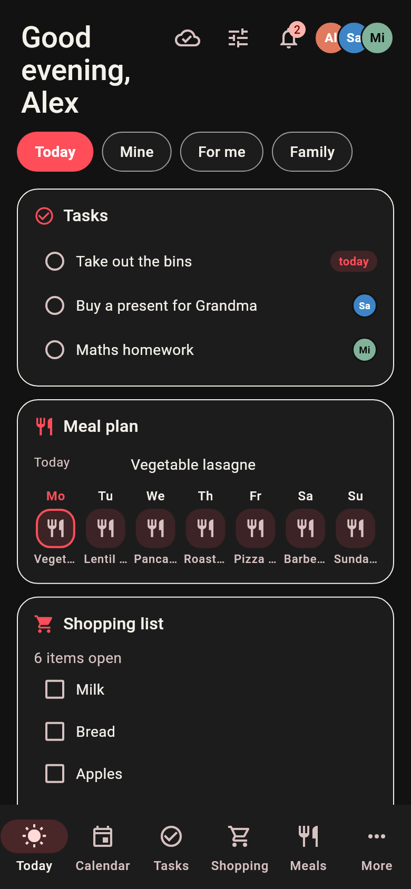</a> | **Swiss Bauhaus**<br>Bauhaus/Swiss style: red, navy and yellow, square cards, heavy uppercase titles. | `https://github.com/Brottuetchen/familienhub-themes/blob/main/swiss-grid/theme.json` |

## Make your own

A theme is one `theme.json` with colours and a few style switches, no code. Format and rules: [docs/themes.md](https://github.com/Brottuetchen/familienhub/blob/main/docs/themes.md). Pull requests with new themes are welcome. Please add a folder with:

- `theme.json`
- `preview-light.png` and `preview-dark.png`, real renders of the Today tab at 390 x 844 (2x), and a row in the table above.

Generate the previews with the public app, using its fictional demo family (needs git and Flutter):

```sh
tools/render-previews.sh my-theme
```

See [tools/README.md](tools/README.md) for details. Check the PNGs by eye before committing; the render shows exactly what the app does with your `theme.json`.

## License

The gallery is [CC0 1.0](LICENSE). Präzision's original theme remains under MIT; see [LICENSE-PRAEZISION](LICENSE-PRAEZISION).
