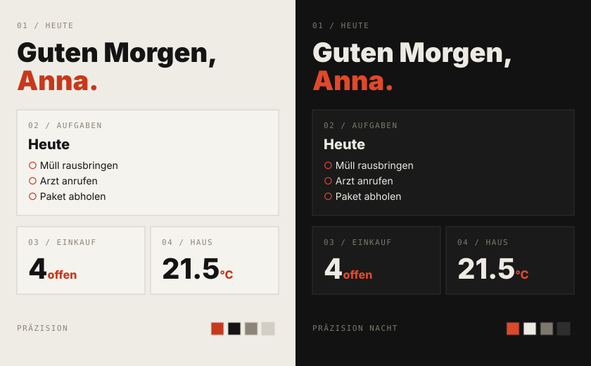

# Präzision

A technical measurement-report look for Familienhub: warm paper white, near-black text, a single signal red-orange accent, square panels with fine borders, bold grotesk headings and monospace labels.

## Install

As an admin, open **More → Appearance → From GitHub** and paste:

`https://github.com/Brottuetchen/familienhub-themes/blob/main/praezision/theme.json`

The file contains both light and dark variants. Set **Automatic / Light / Dark** in **More → Appearance**.

For older Familienhub versions without theme variants, the standalone dark theme is available at `dunkel/theme.json` (Präzision Nacht).

## License

MIT. See [LICENSE](LICENSE).
